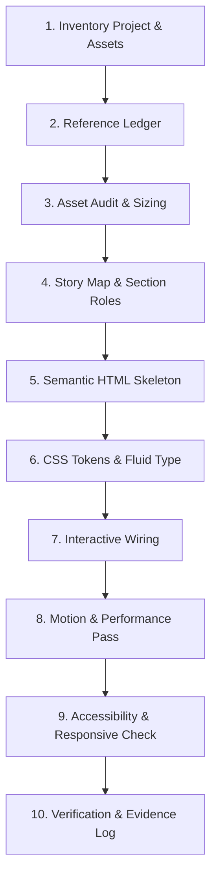

# Apple-Inspired Design System Skill (v1.0 Canonical)

Use this skill when tasked with building, styling, cloning, or refactoring product landing pages, storytelling sites, marketing pages, or interactive design systems inspired by Apple's design language.

## 1. Primary Objective & Philosophy
Turn supplied screenshots, visual designs, or requirements into a complete, responsive, and working product website. The deliverable is fully implemented, accessible code (HTML, CSS, JS) — not just generic advice or disconnected snippets.

### Non-Negotiable Core Tenets
1. **Preserve Story Sequence:** The order of sections in a reference is an editorial story (Introduce → Reveal → Explain → Showcase → Explore → Detail → Resolve). Never scramble section orders into generic templates.
2. **Build the Entire Page:** Deliver from the global notification & navigation bar down to the legal footer links. No placeholder buttons, broken hashes (`href="#"`), or missing sections.
3. **Restrained, Agency-Preserving Motion:** Keep native document scroll intact. Never hijack scrolling with virtual inertia. Use `transform` and `opacity` only. Respect `prefers-reduced-motion`.
4. **Evidence-Based Transparency:** Mark findings as `OBSERVED`, `INFERRED`, or `UNKNOWN`. Never claim unverified 60fps or pixel-perfect equivalence without measured testing.

---

## 2. The 10-Step Reference-Cloning Pipeline



1. **Inventory:** Catalog all existing files, assets, scripts, stylesheets, and target routes before modifying.
2. **Reference Ledger:** For each screenshot/mockup, record:
   - Viewport width & scroll offset
   - Section role (`OBSERVED`)
   - Visible copy & typographic hierarchy
   - Component state (open, active, inactive)
3. **Asset Audit:** Check aspect ratios, dimensions, focal crops, and resolutions. Avoid replacing real product assets with generic stock photos.
4. **Story Map:** Create a structural manifest:
   - `01-globalbar`: Brand, global links, mobile menu toggle
   - `02-productbar`: Sticky sub-navigation, product title, anchor links, "Buy" CTA
   - `03-hero`: Cinematic headline, gradient text, high-impact product render, primary CTA
   - `04-statement`: Punchy philosophical/value proposition statement
   - `05-features`: Asymmetrical feature grid / bento cards
   - `06-showcase`: Media close-up / hardware details with status indicator
   - `07-explorer`: Segmented tab buttons updating live detail panel
   - `08-rail`: Horizontal swipeable card carousel with arrow navigation
   - `09-faq`: Native `<details>` / `<summary>` accordion
   - `10-closing`: Final call to action
   - `11-footer`: Directory links, copyright, accessibility & legal disclaimers
5. **Full Page HTML:** Write clean, valid HTML5 with semantic tags (`<header>`, `<nav>`, `<main>`, `<section>`, `<article>`, `<footer>`). Ensure unique element IDs and zero duplicate IDs.
6. **Token-Driven CSS:**
   - Centralize variables in `:root` or dark/light theme blocks.
   - Use fluid `clamp()` calculations for headers and margins.
   - Use CSS Grid and Flexbox for predictable geometry.
7. **Interactive Wiring (Vanilla JS):**
   - Mobile menu toggle (`aria-expanded`, hidden toggle).
   - Sticky navigation state transitions.
   - Segmented control selection (`aria-pressed`, live region).
   - Carousel drag/scroll tracking (`scrollLeft` stepping, arrow state updating).
   - Keyboard accessibility (`Tab`, `Enter`, `Escape`, `ArrowLeft`, `ArrowRight`).
8. **Motion Pass:**
   - Entrance transitions via `IntersectionObserver` adding `.in-view`.
   - Small travel distances (`translateY(16px)` to `0`).
   - Timing curves: `cubic-bezier(0.16, 1, 0.3, 1)` (spring-like ease-out).
   - Strictly avoid animating `height`, `width`, `top`, `margin`, or expensive `filter: blur()`.
9. **Accessibility & Responsive Pass:**
   - 4.5:1 text contrast ratio on both dark and light modes.
   - Visible outline focus rings (`:focus-visible`).
   - Screen reader attributes (`aria-label`, `aria-live="polite"`, `role="group"`).
   - Smooth scaling across 360px (mobile), 768px (tablet), 1024px (laptop), 1440px+ (desktop).
10. **Evidence & Quality Gate:**
    - Run `python tools/scripts/validate_project.py`
    - Run `node --check <scripts>`
    - Confirm zero console errors.

---

## 3. Design Tokens & Styling Cheat Sheet

### Dark Mode Palette (Primary)
```css
:root {
  --bg-primary: #08090b;
  --bg-secondary: #121316;
  --bg-card: rgba(255, 255, 255, 0.05);
  --bg-card-hover: rgba(255, 255, 255, 0.08);
  --border-subtle: rgba(255, 255, 255, 0.1);
  --border-strong: rgba(255, 255, 255, 0.2);
  --text-primary: #f5f5f7;
  --text-secondary: #86868b;
  --text-muted: #6e6e73;
  --accent-blue: #2997ff;
  --accent-blue-hover: #0077ed;
  --glass-bg: rgba(15, 17, 21, 0.78);
  --glass-blur: blur(20px);
}
```

### Light Mode Palette
```css
[data-theme="light"] {
  --bg-primary: #fbfbfd;
  --bg-secondary: #f5f5f7;
  --bg-card: #ffffff;
  --bg-card-hover: #fafafa;
  --border-subtle: rgba(0, 0, 0, 0.08);
  --border-strong: rgba(0, 0, 0, 0.16);
  --text-primary: #1d1d1f;
  --text-secondary: #6e6e73;
  --text-muted: #86868b;
  --accent-blue: #0071e3;
  --accent-blue-hover: #0077ed;
  --glass-bg: rgba(255, 255, 255, 0.82);
}
```

### Fluid Typography Scale
```css
--font-display: -apple-system, BlinkMacSystemFont, "SF Pro Display", "Helvetica Neue", sans-serif;
--font-body: -apple-system, BlinkMacSystemFont, "SF Pro Text", "Helvetica Neue", sans-serif;

--text-hero: clamp(2.5rem, 6vw + 1rem, 5.5rem);
--text-h2: clamp(2rem, 4vw + 0.5rem, 3.75rem);
--text-h3: clamp(1.25rem, 2vw + 0.5rem, 1.75rem);
--text-body: 1.0625rem; /* 17px Apple body default */
--text-eyebrow: 0.8125rem; /* 13px */

--tracking-display: -0.025em;
--tracking-headline: -0.015em;
--tracking-eyebrow: 0.06em;
```

---

## 4. Key Component Blueprints

### A. Sticky Dual Navigation
```html
<header class="globalbar">
  <div class="nav-content">
    <a class="brand" href="#top" aria-label="Brand Home">◉</a>
    <nav class="globalnav">
      <a href="#store">Store</a>
      <a href="#features">Features</a>
      <a href="#specs">Specs</a>
      <a href="#support">Support</a>
    </nav>
  </div>
</header>
<nav class="productbar" aria-label="Product navigation">
  <div class="product-content">
    <span class="product-name">ProBook</span>
    <div class="product-actions">
      <a href="#overview">Overview</a>
      <a href="#features">Tech Specs</a>
      <a class="btn-buy" href="#buy">Buy</a>
    </div>
  </div>
</nav>
```

### B. Segmented Feature Explorer
```html
<section class="explorer" id="explore">
  <div class="explorer-tabs" role="group" aria-label="Feature Selection">
    <button class="tab-btn active" data-feature="display" aria-pressed="true">Display</button>
    <button class="tab-btn" data-feature="chip" aria-pressed="false">Apple Silicon</button>
    <button class="tab-btn" data-feature="battery" aria-pressed="false">Battery</button>
  </div>
  <div class="explorer-card" aria-live="polite" id="feature-display">
    <h3 id="tab-title">Liquid Retina XDR.</h3>
    <p id="tab-desc">Extreme Dynamic Range and incredible 1,000,000:1 contrast ratio.</p>
  </div>
</section>
```

### C. Snap Horizontal Card Rail (Native Smooth Scroll)
```css
.card-rail {
  display: flex;
  gap: 20px;
  overflow-x: auto;
  scroll-snap-type: x mandatory;
  scroll-behavior: smooth;
  -webkit-overflow-scrolling: touch;
  padding: 24px 0;
}
.rail-card {
  flex: 0 0 clamp(280px, 80vw, 420px);
  scroll-snap-align: start;
  border-radius: 24px;
  background: var(--bg-card);
  border: 1px solid var(--border-subtle);
  padding: 32px;
}
```

---

## 5. Definition of Done & Quality Gate

Before declaring any implementation finished:
- [ ] Story sequence strictly matches reference evidence.
- [ ] Responsive behavior verified from 320px to wide desktop.
- [ ] All interactive components (menu, tabs, rail, accordions) fully wired and accessible.
- [ ] No layout shifting or expensive scroll thrashing.
- [ ] `prefers-reduced-motion` media queries disable transforms/animations.
- [ ] Passes `python tools/scripts/validate_project.py` with zero missing links or duplicate IDs.
- [ ] JS files pass `node --check`.
- [ ] Clear attribution disclaimer included: *Independent reference-informed study. Not affiliated with Apple Inc.*
